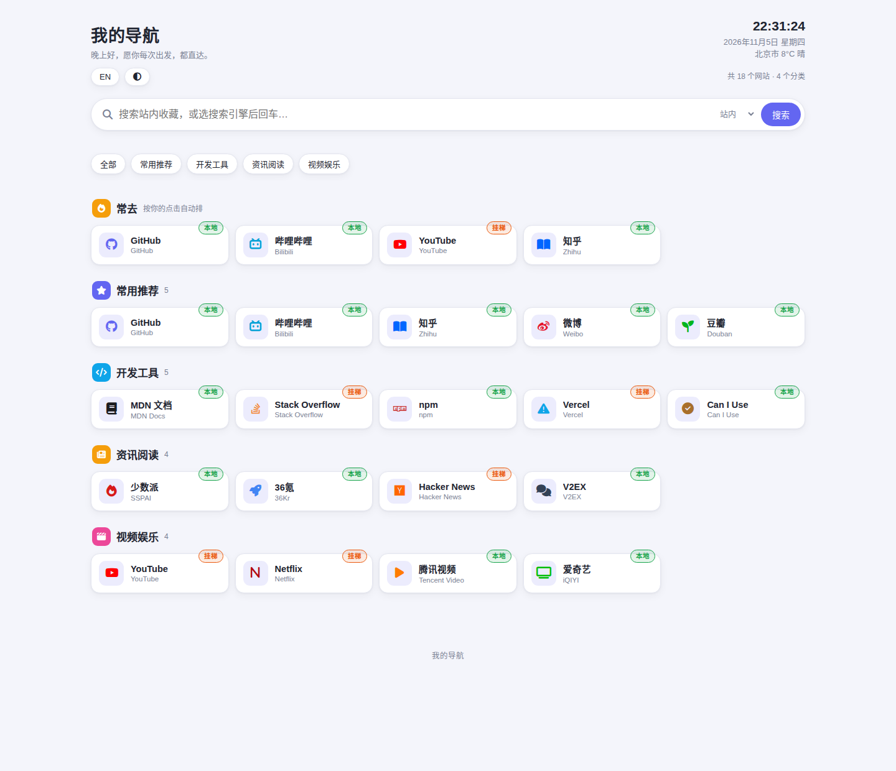
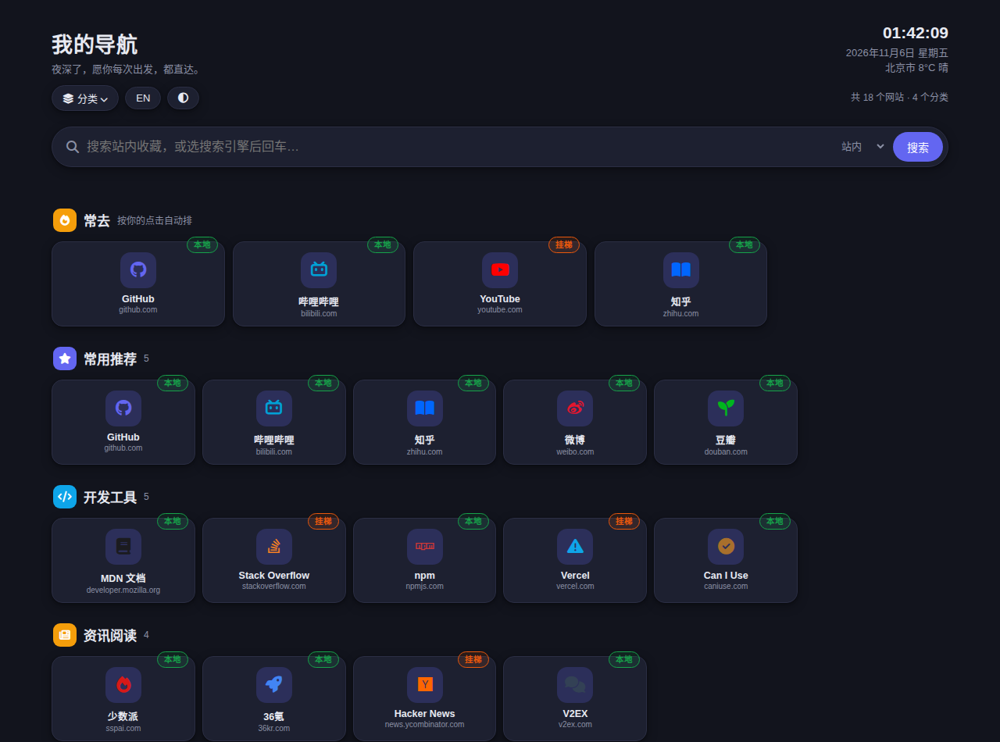
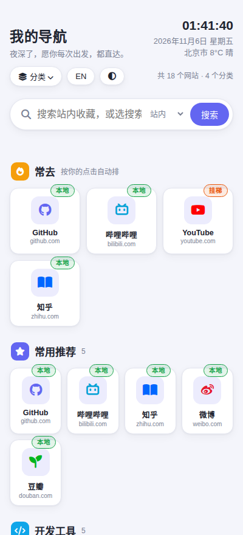

# YM Nav · 个人导航

一个为自己使用习惯写的个人网址导航站：界面清爽、后台顺手、数据完全归自己。
基于 **Cloudflare Pages + Pages Functions + Workers KV** 构建，全部运行在免费额度内，无需服务器、无需数据库。


> 本项目为个人自用而作，**不提供在线体验**：演示站必然要放真实收藏，收藏是私人的。
> 想看效果请看下方「效果预览」（示例数据渲染），或按「快速部署」三分钟搭一个自己的。

---

## ✨ 特性

### 🧭 浏览体验

- **分类分区布局**：首页按分类成块堆叠展示（分区卡片风），顶部分类导航条一键定位；「全部」视图永远按分类分组，不会串行错位
- **顶部大搜索**：站内实时过滤，也可切换百度 / Google / Bing / GitHub 等外部搜索引擎
- **时钟与天气**：实时时钟、问候语；天气按浏览器定位 → IP 定位自动获取（定位结果缓存 24 小时），城市名使用简体中文地名服务
- **常去自动区**：内置点击计数，打开多的网站自动排进首页「常去」区，越用越顺手
- **深浅色与壁纸**：跟随系统或手动切换深色模式；支持自定义壁纸；中英双语站名一键切换

### 🏷️ 数据模型（本项目最在意的两件事）

- **分类即顺序**：数据按分类存储，没有全局排序编号。在某个分类里新增网站，它自动排在该分类末尾——告别"加一个站要重排全部序号"
- **本地 / 挂梯徽标**：网络可达性是链接的正式字段（`badge: local / proxy`），以彩色小标签显示在卡片角上，不再拼进网站名字里

### 🔐 后台与安全

- **真服务端鉴权**：管理员密码以加盐 SHA-256 哈希存放在 KV 的独立 key 中，登录使用 HttpOnly 会话 Cookie（7 天有效）；所有写数据接口一律校验会话，不是前端摆设
- **唯一的后台入口**：双击首页大标题（站名）打开登录框——页面上没有任何显眼的管理按钮（手机端为双击手势识别，不依赖浏览器原生 dblclick）
- **隐私可见性**：整个分类或单个链接都可设为「仅登录可见」，未登录访客的接口响应里根本不包含这些数据（服务端剔除，不是前端隐藏）
- **代码与数据分离**：仓库里只有代码，部署出来是空站；你的收藏、密码、点击记录只存在你自己的 KV 里，谁 fork 这份代码都带不走你的数据

### 🛠️ 管理功能

- 分类与链接的增删改、分类内排序（上移 / 下移）、跨分类移动
- **数据导入导出**：JSON 整体备份 / 恢复；CSV（区域，网站名称，英文名称，网址，徽标）导入导出；浏览器书签 HTML 导入导出
- **收藏小工具**：书签小工具（bookmarklet），在任何网页一键把当前页收藏进本站；也支持 `/?add=网址` 快速收藏
- 键盘快捷键：`/` 聚焦搜索框，`Esc` 清空搜索
- KV 暂时读不到时自动用浏览器本地缓存顶上，不白屏

---

## 🖼️ 效果预览

以下截图由示例数据渲染（站名、分类与链接均为演示内容）：

| 桌面端 · 浅色 | 桌面端 · 深色 |
| --- | --- |
|  |  |

| 移动端 |
| --- |
|  |

---

## 🚀 快速部署

### 方式一：Git 连接部署（推荐）

1. Fork 或克隆本仓库到你的 GitHub。
2. Cloudflare 控制台 → Workers 和 Pages → 创建 → Pages → 连接到 Git，选择本仓库；构建命令留空，输出目录填 `/`，部署。
3. 控制台 → 存储和数据库 → KV → 创建命名空间（名字随意）。
4. 回到 Pages 项目 → 设置 → 绑定 → 添加 KV 命名空间绑定，变量名必须为 **`NAV_KV`**，选刚建的命名空间；保存后重新部署一次使绑定生效。
5. （可选）在 Pages 项目 → 自定义域 里绑上你的域名。
6. 打开站点，**双击首页大标题**，首次会让你设置管理员账号和密码，设完自动登录；之后在后台「数据」里导入备份，或逐个添加。

> ⚠️ 实测教训：不推荐「直接上传」zip 的方式——某些情况下直传部署不会生成 Functions，`/api/*` 会全部失效（表现为打开网页正常、但登录和数据都不工作）。Git 连接部署没有这个问题，且之后改代码推送即自动更新。

### 方式二：直接上传（仅作备选）

将仓库文件打包（`index.html` 与 `functions/` 位于压缩包根目录）后在 Pages 创建时选择上传；其余 KV 绑定步骤同上。若部署后 `/api/config` 返回的不是 JSON，请改用方式一。

---

## 🔧 变量与存储说明

| 名称 | 说明 |
| --- | --- |
| `NAV_KV` | Pages 项目必须绑定的 KV 变量名（代码写死，不要改名） |

KV 内部 key 一览：

| Key | 内容 |
| --- | --- |
| `site_config` | 整站数据（一份 JSON：设置 + 全部分类与链接） |
| `admin` | 管理员账号、密码盐与 SHA-256 哈希 |
| `sess:<token>` | 登录会话（7 天 TTL，自动过期） |
| `clicks` | 各链接点击计数（用于「常去」区） |

---

## 🗄️ 数据结构

整站数据就是 `site_config` 里的一份 JSON：

```jsonc
{
  "version": 1,
  "settings": {
    "siteName": "我的导航", "siteNameEn": "My Nav",
    "wallpaper": "", "theme": "auto",
    "colsDesktop": 5, "colsMobile": 3,
    "showFrequent": true, "openInNewTab": true
  },
  "sections": [
    {
      "id": "sec_x", "title": "常用推荐", "titleEn": "Recommended",
      "icon": "fa-solid fa-star", "accent": "#6366f1",
      "layout": "card", "linkStyle": "icon",
      "links": [
        { "id": "link_x", "name": "哔哩哔哩", "nameEn": "Bilibili",
          "url": "https://www.bilibili.com/", "icon": "fab fa-bilibili",
          "color": "", "badge": "local" }
      ]
    }
  ]
}
```

- `layout`：`card` 标准卡片 / `wide` 宽卡片；`linkStyle`：`icon` 图标风 / `text` 纯文字
- `badge`：`local` 本地直连（绿）/ `proxy` 需代理（橙）/ 留空不显示
- 分类或链接加 `"private": true` 即对未登录访客完全隐藏

---

## ❓ 常见问题

**怎么进后台？**
双击首页的大标题（站名）。没有别的入口，这是故意的。

**管理员密码忘了怎么办？**
到 Cloudflare 控制台的 KV 里删掉 `admin` 这个 key，再打开站点双击标题，会重新进入首次设置流程（数据不受影响）。

**换设备 / 换浏览器后数据还在吗？**
在。数据存在 Cloudflare KV 里，与设备无关；任何设备打开站点看到的都是同一份数据。

**怎么备份？**
后台「数据」→ 导出 JSON，存好那个文件即可；恢复时在同一处导入。

**为什么没有在线演示？**
导航站的价值就是里面收藏的网址，那些是个人数据，不适合公开。效果看「效果预览」的截图就够了，部署一个自己的只要几分钟。

---

## 🛠️ 技术栈

| 层 | 选型 |
| --- | --- |
| 前端 | 单文件 `index.html`（原生 JS，无框架、无构建步骤） |
| 后端 | Cloudflare Pages Functions |
| 存储 | Cloudflare Workers KV |
| 鉴权 | 加盐 SHA-256 + HttpOnly Cookie 会话 |
| 天气 | Open-Meteo（免 key）+ OpenStreetMap Nominatim 地名（简体） |

## 📁 目录结构

```text
.
├── index.html               # 全部前端（单文件）
├── functions/
│   ├── _auth.js             # 鉴权与工具函数
│   └── api/
│       ├── config.js        # 读 / 存整站数据（未登录时剔除隐私内容）
│       ├── login.js         # 登录
│       ├── logout.js        # 退出
│       ├── setup.js         # 首次设密 / 改密码
│       └── click.js         # 点击计数
└── docs/                    # 效果预览图
```

## 📝 更新日志

### v1.0 · 2026-11-05

- 首个完整版本：分区布局 + 顶部搜索 + 真服务端鉴权 + 本地/挂梯徽标 + 常去区 + 隐私可见性
- 后台入口改为双击站名（手机端手势识别）；代码默认站名改为中性占位，个人数据零写死
- 天气定位改为定位 → IP → 默认的三级兜底，地名统一简体

---

*为自己而作的工具，顺手最重要。*
